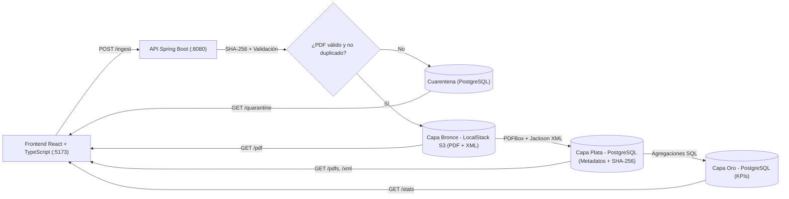
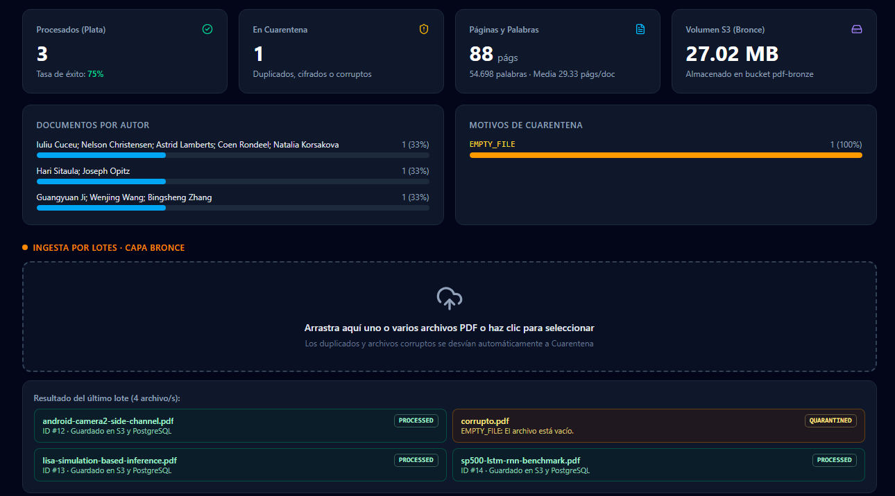
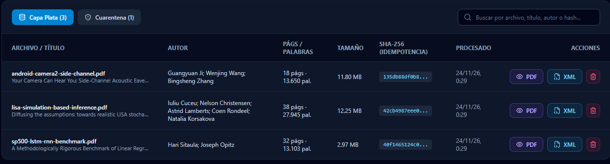
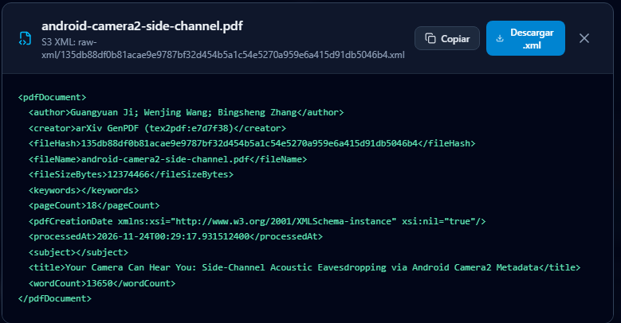
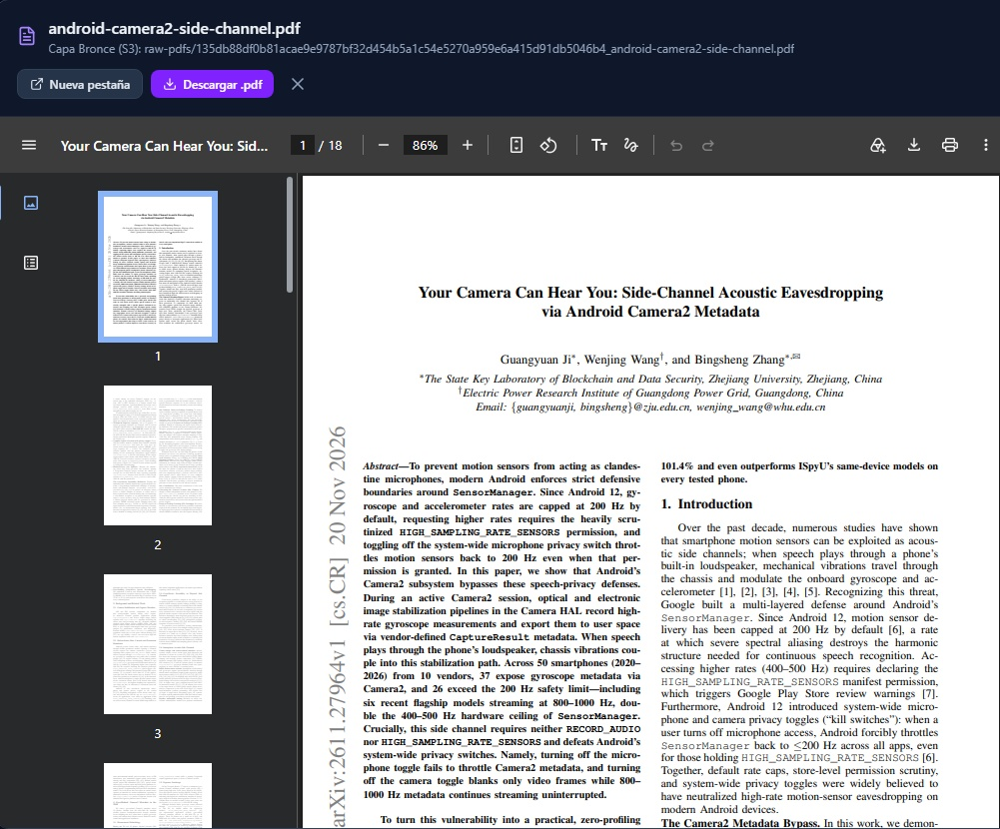
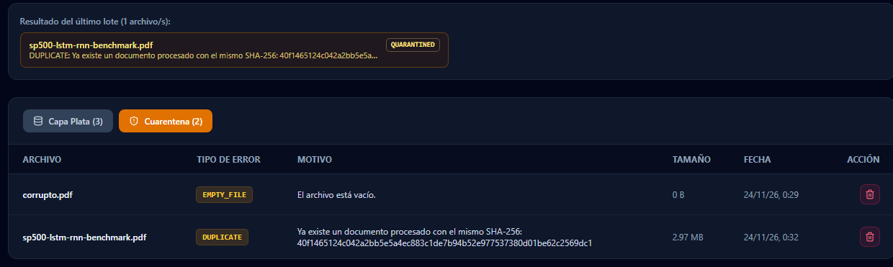

# PDF ETL Data Pipeline

Pipeline ETL completo para la ingesta por lotes, validación, extracción de metadatos, transformación a XML y analítica de documentos PDF siguiendo una arquitectura Medallion (Bronce, Plata y Oro).

Desarrollado como  proyecto de ingeniería de datos local utilizando Java 21, Spring Boot, PostgreSQL, LocalStack (S3) y React con TypeScript.

## Arquitectura



El flujo de datos se divide en cuatro zonas:

* **Capa Bronce (LocalStack S3):** guarda el archivo PDF original con el nombre saneado y el documento XML resultante en el bucket `pdf-bronze`.
* **Capa Plata (PostgreSQL):** almacena los metadatos limpios extraídos con Apache PDFBox (título, autor, páginas, conteo de palabras, tamaño y fecha) junto con el hash SHA-256 para evitar reprocesamientos.
* **Cuarentena (PostgreSQL):** registra archivos duplicados (`DUPLICATE`), corruptos (`CORRUPT_OR_INVALID_PDF`) o no legibles sin detener el resto del lote.
* **Capa Oro (PostgreSQL):** calcula los indicadores agregados (`SUM`, `AVG`, `COUNT`, `GROUP BY`) directamente en base de datos mediante consultas JPQL.

## Funcionalidades

* Ingesta por lotes desde el navegador mediante drag & drop, devolviendo el resultado individual de cada archivo (`PROCESSED` o `QUARANTINED`).
* Control de idempotencia mediante hash SHA-256 antes de subir a S3 o insertar en base de datos.
* Generación de XML estructurado con Jackson 3 XML, con visor integrado, copiado y descarga.
* Previsualización de PDFs originales recuperados directamente desde LocalStack S3.
* Borrado coordinado entre capas: eliminar un documento borra el registro en PostgreSQL, elimina sus objetos en S3 y actualiza las métricas de la Capa Oro.
* Búsqueda en tiempo real por nombre de archivo, título, autor o hash y tabla de auditoría para la cuarentena.

## Stack tecnológico

| Área | Tecnologías |
| :--- | :--- |
| Backend | Java 21, Spring Boot 4.2.0, Spring Data JPA, Lombok |
| ETL y almacenamiento de objetos | Apache PDFBox 3.0.3, Jackson 3 XML (`tools.jackson.dataformat`), cliente MinIO/S3 |
| Base de datos y almacenamiento | PostgreSQL 16, LocalStack 3.8 (S3) |
| Frontend | React, TypeScript, Vite, Tailwind CSS, Lucide |
| Infraestructura | Docker, Docker Compose |

## Estructura del repositorio

```text
pdf-etl-pipeline/
├── pdf-etl-pipeline/          # Backend Spring Boot (Java 21)
│   ├── src/main/java/.../
│   │   ├── controller/        # Controlador REST
│   │   ├── dto/               # Records para analítica y XML
│   │   ├── model/             # Entidades JPA (PdfMetadata, QuarantineRecord)
│   │   ├── repository/        # Repositorios JPA y consultas JPQL
│   │   └── service/           # Lógica ETL, SHA-256, S3 y métricas
│   └── docker-compose.yml     # PostgreSQL 16 y LocalStack 3.8
├── frontend/                  # Dashboard en React + TypeScript
│   └── src/
│       ├── components/        # PdfModal, XmlModal, ConfirmModal
│       ├── services/          # Cliente HTTP hacia la API
│       └── types/             # Tipos TypeScript
└── README.md
```

## Ejecución en local

### Requisitos previos
* Docker Desktop en ejecución
* JDK 21 y Maven
* Node.js 20 o superior

### 1. Clonar el repositorio
```bash
git clone [https://github.com/danielcebri06/pdf-etl-pipeline.git](https://github.com/danielcebri06/pdf-etl-pipeline.git)
cd pdf-etl-pipeline
```

### 2. Levantar PostgreSQL y LocalStack S3
```bash
cd pdf-etl-pipeline
docker compose up -d
```
Comprueba con `docker ps` que `pdf_pipeline_db` (puerto `5432`) y `pdf_pipeline_s3` (puerto `4566`) están activos.

### 3. Iniciar el backend
Desde `pdf-etl-pipeline/`:
```bash
./mvnw spring-boot:run
```
En Windows PowerShell usa `.\mvnw.cmd spring-boot:run`. Al arrancar, la aplicación crea el bucket `pdf-bronze` en LocalStack si no existe y expone la API en `http://localhost:8080`.

### 4. Iniciar el frontend
En otra terminal, desde la raíz del proyecto:
```bash
cd frontend
npm install
npm run dev
```
La interfaz queda disponible en `http://localhost:5173`.

## Endpoints de la API

Base URL: `http://localhost:8080/api/v1/pdfs`

| Método | Ruta | Descripción |
| :--- | :--- | :--- |
| `POST` | `/ingest` | Ingesta de uno o varios PDFs (`multipart/form-data`, campo `files`) |
| `GET` | `/` | Listado de documentos procesados en Capa Plata |
| `GET` | `/{id}/xml` | XML generado del documento (`application/xml`) |
| `GET` | `/{id}/pdf` | PDF original recuperado desde LocalStack S3 (`application/pdf`) |
| `GET` | `/quarantine` | Listado de archivos rechazados y motivo del fallo |
| `GET` | `/stats` | Métricas agregadas de la Capa Oro |
| `DELETE` | `/{id}` | Elimina el registro en PostgreSQL y sus archivos asociados en S3 |
| `DELETE` | `/quarantine/{id}` | Elimina un registro de la tabla de cuarentena |


## Capturas

### Capa Oro e ingesta por lotes


### Capa Plata e idempotencia (SHA-256)


### Transformación a XML


### Previsualización desde Capa Bronce (S3)


### Auditoría de Cuarentena
